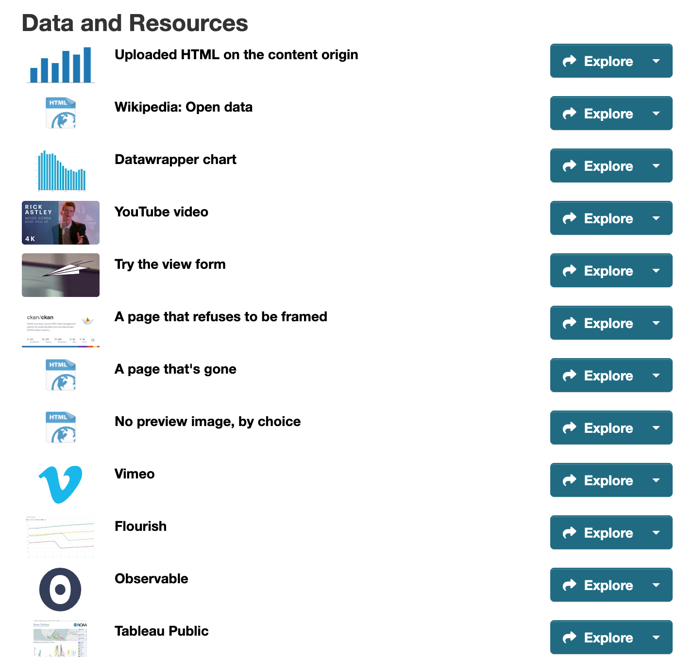

[](https://github.com/dathere/ckanext-webpageviewplus/actions)
[](https://pypi.org/project/ckanext-webpageviewplus/)
[](https://app.codacy.com/gh/dathere/ckanext-webpageviewplus/dashboard)
[](https://app.codacy.com/gh/dathere/ckanext-webpageviewplus/coverage)

# ckanext-webpageviewplus

Show web pages and uploaded HTML inside CKAN, safely. This extension replaces CKAN's built-in
[rudimentary](https://github.com/ckan/ckan/tree/master/ckanext/webpageview)
[webpage_view](https://docs.ckan.org/en/latest/maintaining/data-viewer.html#web-page-view) with a
"Website (Plus)" view. It puts a dashboard, chart, video, form or uploaded HTML page (such as a
[qsv](https://github.com/dathere/qsv#qsv-blazing-fast-data-wrangling-toolkit)
[Data Schematic](https://dathere.com/2026/08/data-schematic-a-neuro-symbolic-visual-story-telling-data-explorer-dictionary/))
on a resource's page, with a security setting per view, a height that fits the page, and
buttons to open it in a new tab or full screen. It runs beside `webpage_view`, so you can move
your views over when you're ready. A second view, "PDF (Plus)", shows PDFs with the bundled
PDF.js viewer, the same in every browser and on phones.


## Why use it

**It keeps your login and your private data safe.** When you're signed in to CKAN, your browser
lets CKAN's pages see your private datasets and make changes in your name. Out of the box, CKAN
shows an uploaded web page (a chart, a report, a dashboard) on CKAN's own address, so your
browser trusts that page just as much. If the page has harmful code in it, uploaded by mistake
or from a hijacked account, then simply opening it lets that code, without you noticing:

- read every private dataset and file you can see, and your profile, email included;
- change or delete the datasets you can edit;
- add or remove people in organizations you manage, or change their roles;
- create an API key in your name and send it to someone else;
- if you're a sysadmin, do anything on the site, including reading every user's email.

Visitors who aren't signed in are at risk too: the page can show a fake sign-in form on your
site's real address and send the password to someone else. The file needn't end in `.html`:
CKAN serves it as whatever type its resource says, which editors can set. Uploaded SVG images
opened on their own carry the same risk.

Stock `webpage_view` shows uploaded pages the same way. A site it embeds can't see your login by
itself, but nothing stops that site from sending its frame to a harmful upload. And anyone who
can edit a dataset can type a `javascript:` address as its page, which runs code with your login
for everyone who opens the view, no upload needed. This extension:

- always shows uploaded pages and CKAN's own pages in a sandbox, a locked box whose code can't
  use your login;
- does the same when someone downloads an uploaded HTML, SVG or XML file and opens it;
- accepts only web addresses as pages to embed, never `javascript:`;
- with a [separate domain for uploads](#a-separate-domain-for-uploads), moves uploaded pages off
  your site's address altogether, onto one your browser doesn't trust with your login. In a view
  they're still sandboxed; opened on their own, that other address is what keeps them away from
  your login, and a fake sign-in form there no longer looks like your site.

**It makes embedded pages look and work better.** Heights that fit the page, a control bar,
help for editors pasting links from well-known services, and a card explaining why a page
can't be shown instead of a blank box. It works on phones and tablets, and with keyboards and
screen readers.

**It shows PDFs everywhere.** With a separate domain for uploads, the PDF (Plus) view shows
uploaded and linked PDFs with PDF.js, which ships with the extension, so phones show them too,
and a PDF's own scripts never run in the view. One command converts ckanext-pdfview's views.

**It respects visitors' privacy.** Nothing is tracked by default. Sites can ask visitors before
loading third-party pages, and opt in to anonymous view counts.

### Compared with what it replaces

**Web pages: `webpage_view` (CKAN core) and Website (Plus)**

| | `webpage_view` (CKAN core) | Website (Plus) (`webpage_view_plus`) |
| --- | --- | --- |
| Security | none: embedded pages run unrestricted, and uploaded pages can use the visitor's login | a security preset per view, checked when it's saved and when it's shown |
| Uploaded HTML | can use the visitor's login, in the view and from its download link | sandboxed, or served from a separate domain |
| Page address | any text, unchecked | web addresses only, optionally limited to sites you list |
| Height | 600 px for other sites | fixed, a share of the window, an aspect ratio such as 16:9, or automatic (the page says how tall it is; qsv Data Schematics do it themselves) |
| Loading | right away | when scrolled into view; on request for visitors saving data; optionally only after the visitor agrees |
| Controls | CKAN's Fullscreen and Embed links | the same, plus a bar under the view: Open in new tab, Fullscreen (Expand on iPhone), Reload, Share |
| Accessibility | a generic "Webpage view" title | the view's title read out, a skip link, announcements, works at 400% zoom |
| Pages that can't be shown | a blank frame | a card saying why, with Open in new tab |
| Editor help | none | paste a link from one of 30 well-known services and the form fills in the embed settings; optional warning when a site refuses to be embedded |
| Resource list | a format label | optionally a thumbnail: an image the editor picks, the page's own preview image, or the service's thumbnail or logo |
| Finding broken views | none | one command lists views (core's too) whose page is gone or refuses to be embedded |
| Telemetry | none | none by default; opt-in view counting |
| Languages | CKAN's | English, German, Spanish, French, Italian, Japanese and Brazilian Portuguese |
| Moving over | n/a | `ckan webpageviewplus migrate` converts existing views in place |

**Office files and PDFs.** The Microsoft Office service is compared with
[ckanext-officedocs](https://github.com/jqnatividad/ckanext-officedocs) under
[Office files compared with ckanext-officedocs](#office-files-compared-with-ckanext-officedocs),
and the PDF (Plus) view with [ckanext-pdfview](https://github.com/ckan/ckanext-pdfview) under
[PDF (Plus) compared with ckanext-pdfview](#pdf-plus-compared-with-ckanext-pdfview).

## Requirements

| CKAN version    | Compatible? |
| --------------- | ----------- |
| 2.9 and earlier | no          |
| 2.10            | yes         |
| 2.11            | yes         |
| 2.12            | yes         |

**Browsers: Chrome and Edge 88+, Firefox 89+ and Safari 15+ (macOS, iOS and iPadOS)**, all from
2021. The security protection works in every browser still in use; older browsers just show
less around the view. The PDF (Plus) view needs recent browsers (Chrome and Edge 125+,
Firefox ESR 153 or a newer Firefox, Safari 18+). Internet Explorer isn't supported. Details are under
[Browser support](#browser-support).

A separate domain for uploads is optional, and needs a second, separately registered domain
name. See [A separate domain for uploads](#a-separate-domain-for-uploads). The PDF (Plus) view
needs one, and `ckan.storage_path` set to show PDFs linked from other sites.


## Installation

1. Activate your CKAN virtual environment, for example:

       . /usr/lib/ckan/default/bin/activate

2. Install the extension:

       pip install ckanext-webpageviewplus

   For thumbnails in the resource list, install it with Pillow instead:

       pip install "ckanext-webpageviewplus[thumbnails]"

   (or, for unreleased changes, `pip install git+https://github.com/dathere/ckanext-webpageviewplus.git`)

3. Add the plugins you want to `ckan.plugins` in your CKAN config file (by default
   `/etc/ckan/default/ckan.ini`), `webpage_view_plus` first:

   | Plugin | Adds | Needs |
   | --- | --- | --- |
   | `webpage_view_plus` | the Website (Plus) view: web pages, uploaded HTML, well-known services, Office files | nothing |
   | `webpage_view_plus_thumbnails` | [thumbnails in the resource list](#thumbnails-in-the-resource-list) | `webpage_view_plus`, and Pillow (the `[thumbnails]` extra) |
   | `pdf_view_plus` | the [PDF (Plus) view](#pdf-views) | `webpage_view_plus`, a [separate domain for uploads](#a-separate-domain-for-uploads), and `ckan.storage_path` for PDFs linked from other sites |

   For example:

       ckan.plugins = ... webpage_view_plus webpage_view_plus_thumbnails pdf_view_plus

   CKAN won't start if `webpage_view_plus` is missing or, for thumbnails, Pillow is, and says
   which. Without a separate domain, `pdf_view_plus` loads but offers no view. Keep
   `webpage_view` (and ckanext-pdfview's `pdf_view` or ckanext-officedocs' `officedocs_view`,
   if you use them) enabled until you've moved your views over: `migrate` and `migrate-pdf`
   convert the first two; Office views are added afresh.

4. Create the extension's tables (used only by opt-in view counting, connection reports, the
   frameability check and thumbnails, but run it anyway so turning those on later just works).
   They're all under `webpage_view_plus`, whichever plugins you enable. Run it again after every
   upgrade:

       ckan -c /etc/ckan/default/ckan.ini db upgrade -p webpage_view_plus

5. Restart CKAN. Settings are checked at startup, and an unsafe combination stops CKAN with a
   message naming the setting.

All settings are optional; they're listed under [Config settings](#config-settings).


## Adding a view

Add a "Website (Plus)" view to an HTML resource and pick a security preset:

| Preset | What the page can do | Use for |
| --- | --- | --- |
| `strict` | show its HTML, with no scripts | static HTML: reports, notebooks without JavaScript |
| `interactive` (the default) | run scripts, submit forms, open popups and downloads, but keep no logins or saved data | charts and other scripted pages |
| `external` | everything it could do on its own site | third-party sites you trust (dashboards, apps, videos). Needs a [separate domain for uploads](#a-separate-domain-for-uploads); without one it runs as `interactive`. Never used for uploads or CKAN's own pages |
| `data-schematic` | what `interactive` allows, plus saved data and popups | qsv Data Schematics (maps, Tour, Explore). Needs a separate domain for uploads; without one it runs as `interactive` and maps stay blank |

Editors pick the preset and the height. Sysadmins can also fine-tune a view's sandbox and
browser features (see [How the protection works](#how-the-protection-works)).

**Height.** A view can be a fixed height, a share of the browser window, an aspect ratio (such
as 16:9 for video), or Auto. With Auto, the frame takes the height the page reports, between
`min_height` and `max_height`, and keeps a fallback height until it reports one. qsv Data
Schematics from the release after 27.0.1 report their height themselves; other pages can too
(see [Auto height for your own pages](#auto-height-for-your-own-pages)).

**Well-known services.** Paste a link from one of these as the page URL, and the form offers
the embed address, preset and height that service needs:

- **Charts and dashboards:** Datawrapper, Flourish, Infogram, Our World in Data, Observable,
  Tableau Public, Power BI, Looker Studio
- **Maps:** ArcGIS Online, ArcGIS StoryMaps, CARTO, Felt, uMap, OpenStreetMap
- **Apps and notebooks:** Plotly Cloud, Streamlit, Hugging Face Spaces, shinyapps.io, Jupyter
  notebooks, Google Colab
- **Documents and forms:** Google Sheets, Docs, Slides and Forms, Typeform, and Word, Excel and
  PowerPoint files through Microsoft's online viewer
- **Video and collections:** YouTube, Vimeo, Internet Archive, Sketchfab

Click "Use them" to accept; nothing changes until you do. Only public embeds work. More than half
of these need the `external` preset, and so a separate domain for uploads; on a site without
one, the form says so. The links recognised for
each service, and notes on self-hosted Superset and Dash dashboards, are under
[Well-known services: recognised links](#well-known-services-recognised-links).

**Control bar.** Under each view: Open in new tab, Fullscreen, Reload and Share. A site chooses
the buttons with `ckanext.webpageviewplus.controls`, and editors can hide the bar per view.

- **Open in new tab** and **Reload** go through CKAN's download link for uploads, so a private
  upload's link never goes stale.
- **Fullscreen** becomes **Expand** where the browser has no element fullscreen (iPhone
  Safari): the view fills the screen in place, with Close and Esc to leave. While fullscreen, a
  view that's wider than tall turns an Android phone sideways.
- **Share** opens the browser's share sheet with the CKAN page's address (never the embedded
  page's), where the browser offers one, desktops included.

**Theme.** `ckanext.webpageviewplus.color_scheme = light` (or `dark`) makes embedded pages see
that as the visitor's colour preference, so a qsv schematic matches the portal. Only Firefox
honours it for these frames so far; the default, `auto`, leaves it to the visitor's device.


## Accessibility, phones and tablets

- A **skip link** jumps past each frame to its controls, screen readers announce "*title*
  loaded", and focus outlines and 24 px targets (44 px on touch screens) work in Windows High
  Contrast too. axe-core checks the extension's markup in the browser tests.
- **Reflow:** at 320 px wide (400% zoom), every frame is at least 600 px tall, and a view that
  hides its bar still offers Open in new tab (unless the site's `controls` drops `open`).
- **Responsive height:** below `narrow_width` (576 px of view width by default), views sized by
  aspect ratio or share of the window take 80% of the screen's height. Fixed and auto heights
  don't change.
- **Tap to interact:** on a touch screen, a frame taller than half the screen gets a "Tap to
  interact" overlay, so a swipe scrolls the page instead of getting stuck in the frame. It comes
  back once the frame has scrolled out of view.
- **Load on tap:** when the browser asks to save data (`Save-Data: on`), a card with a Load
  button (and the resource's size, when CKAN knows it) stands in for the page until the reader taps it.


## Keeping your site safe

CKAN's [data viewer docs](https://docs.ckan.org/en/latest/maintaining/data-viewer.html#web-page-view)
say not to enable `webpage_view` unless you trust the URL sources, nor where all users can create
datasets. This extension removes the risk to CKAN itself: no embedded page or upload can run
scripts as CKAN, and editors can't loosen a view's sandbox.

What an embedded page shows is still up to its source. A sandbox limits what a page can reach,
not what it says, so a page can still be misleading, open popups (`interactive`) or load
trackers (see the [consent card](#privacy-and-telemetry)).

**Where anyone can create datasets:**

- set up a [separate domain for uploads](#a-separate-domain-for-uploads);
- keep `ckanext.webpageviewplus.editor_can_loosen` off (the default);
- consider limiting the presets: `ckanext.webpageviewplus.presets = strict interactive
  data-schematic`;
- set `ckanext.webpageviewplus.allowed_hosts` to the sites you embed with a page URL. It doesn't
  cover a view that leaves its page URL empty and shows the resource's own URL, so anyone who
  can create a resource still chooses what it shows.

**Downloads change too.** With this extension enabled, an uploaded HTML page opened from its
download link runs sandboxed, so a page that needs saved data or a real web address (for
example a qsv Data Schematic's maps) loses those features there. With a separate domain for
uploads, downloads go there instead and work fully. See
[Uploaded HTML downloads are sandboxed](#uploaded-html-downloads-are-sandboxed).


## A separate domain for uploads

A **content origin** serves uploaded HTML from a second domain, such as
`https://example-usercontent.org` for a CKAN at `https://data.example.org`, the way GitHub uses
`githubusercontent.com`. Pages there run in full (maps, saved data and all), and the browser
keeps them apart from CKAN's pages, logins and API. It's what lets the `external` and
`data-schematic` presets run as themselves.

It must be a separately registered domain, not a subdomain of CKAN's, pointed at the same CKAN
through your web server, and it takes two settings. The steps are under
[Deploying a content origin](#deploying-a-content-origin). It serves uploads on CKAN's own
disk, and on **CKAN 2.12**, uploads in cloud storage too. On CKAN 2.10 and 2.11, uploads kept by
a cloud storage extension (ckanext-s3filestore, ckanext-cloudstorage) can't be served from it:
they stay sandboxed on CKAN's own address, without maps or saved data. Upgrading to 2.12 and
its file storage removes that limit.

It's also what the [PDF (Plus) view](#pdf-views) needs: its viewer runs only from this domain.


## Optional features

**Warn about pages that refuse to be embedded.** With
`ckanext.webpageviewplus.frameability_check = true`, the view form warns as an editor types the
address of a site that refuses to be embedded, and suggests linking to it instead. Saving a
view checks its page once, and a page that refuses shows a card saying so, with Open in new
tab, instead of a blank box. Visitors never make CKAN fetch anything. Because it makes your
server request addresses that editors type, it's off by default; see
[Frameability check](#frameability-check) for how it's guarded. (An `http://` page on an
`https://` site always gets that card, since browsers block it.)

**Find broken views.** `ckan webpageviewplus check-views` lists the views (core `webpage_view`
ones too) whose page is gone, unreachable or refuses to be embedded. Run it weekly from cron
and have the output mailed to you:

    0 4 * * 1  ckan -c /etc/ckan/default/ckan.ini webpageviewplus check-views

See [Finding broken views](#finding-broken-views) for what it reports.

**Ask before loading third-party pages.** With `consent_gate` (for the site, or per view), a
third-party page waits behind a card, "This view loads content from *host*", until the visitor
asks for it, so nothing is requested from that site before. Visitors can choose
**Always load from *host***, remembered in their own browser. `privacy_profile = eu` puts the
card on every third-party page, and browsers sending Global Privacy Control always get it.
Uploads and CKAN's own pages never need it. See [Privacy and telemetry](#privacy-and-telemetry).

**Count views.** With `view_counting = true` and a `privacy_policy_url`, editors can tick "Count
visits" on a view. Only daily totals per view are kept, with nothing about the visitor, and the
view says it counts visits. See [Opt-in view counting](#opt-in-view-counting).

**Show thumbnails in the resource list.** Install with Pillow
(`pip install ckanext-webpageviewplus[thumbnails]`) and add `webpage_view_plus_thumbnails` to
`ckan.plugins` after `webpage_view_plus`. A dataset's resource list then shows a small image,
instead of the format icon, beside each resource with a Website (Plus) view. With
`thumbnail_fetch = true`, CKAN also takes the page's own preview image when a view is saved. See
[Thumbnails in the resource list](#thumbnails-in-the-resource-list).

**Show PDFs.** Add `pdf_view_plus` to `ckan.plugins` after `webpage_view_plus`, on a site with a
separate domain for uploads. PDF resources then get a PDF (Plus) view: PDF.js, which ships with
the extension, shows uploaded PDFs and PDFs linked from other sites, the same in every browser,
phones included. See [PDF views](#pdf-views).

**See what uploaded pages contact.** With `connection_reports = true` and a content origin,
CKAN notes which other sites uploaded pages fetch from (map tiles, a CDN), and
`show_connections = true` lists them under the view. See
[What uploaded pages contact](#what-uploaded-pages-contact).


## Migrating from webpage_view

`ckan webpageviewplus migrate` converts `webpage_view` views in place, keeping their id, title,
description, order and page URL. It picks `data-schematic` for uploads that contain a qsv
schematic, and the default preset otherwise. To tell, it reads each uploaded page (up to
64 MB), from cloud storage too on CKAN 2.12, even with `--dry-run`. It never stores a preset
the site disallows or the [security rule](#how-the-protection-works) refuses: if none fits, it
skips the view and says so. Back up the database first, and start with a dry run:

    ckan -c /etc/ckan/default/ckan.ini webpageviewplus migrate --dry-run
    ckan -c /etc/ckan/default/ckan.ini webpageviewplus migrate [--uploads-only] [--preset NAME]

**Without a content origin, if your site embeds third-party apps or dashboards, use
`--uploads-only`.** Stock `webpage_view` runs embedded pages unsandboxed, and a migrated
third-party app (running as `interactive`) would lose its own logins and saved settings.
`--uploads-only` converts just the views of uploaded HTML, which gain the most. Linked pages
stay on `webpage_view` until you set up a content origin.


## Translations

The view, its control bar and the view form come in English, German (`de`), Spanish (`es`),
French (`fr`), Italian (`it`), Japanese (`ja`) and Brazilian Portuguese (`pt_BR`), following the
visitor's CKAN language. These are first translations: corrections from native speakers are
very welcome, as pull requests to
`ckanext/webpageviewplus/i18n/<locale>/LC_MESSAGES/ckanext-webpageviewplus.po` (see
[Adding or updating a language](#adding-or-updating-a-language)).

The PDF (Plus) view's toolbar comes from PDF.js's own translations: English and the ten
languages CKAN portals use most, so Thai, Indonesian, Ukrainian and Turkish too (see
[PDF views](#pdf-views)). Other languages show English.

See [CHANGELOG.md](CHANGELOG.md) for what changed in each release.


## FAQ

### For site administrators

- **Q: What exactly does the sandbox stop, and what doesn't it?**<br>
  A: It stops an embedded page from using your visitors' logins. Whether it's another site's page
  or HTML someone uploaded, the page can't read your site's pages, cookies or saved data, can't
  see private datasets, and can't change anything in a visitor's name. Without a separate domain
  for uploads, no frame is ever allowed to run scripts with a real origin, as that's the one
  combination that could open an upload on your site's address and give it the visitor's login.
  It doesn't vouch for what a page says or loads. A page can still be misleading, including a
  fake sign-in form (only a separate domain for uploads takes that off your site's address). And
  loading another site's page still sends that site the visitor's own cookies for it, which is
  what the consent card is for. See [How the protection works](#how-the-protection-works) and
  [Keeping your site safe](#keeping-your-site-safe).

- **Q: Do I need a separate domain for uploads?**<br>
  A: Not to install it. Without one, every view and upload is sandboxed so it can't use your
  visitors' logins, and that's already safer than `webpage_view`. What you lose:
  - An uploaded page still opens on your site's own address, so it can show a convincing fake
    sign-in form there.
  - `external` and `data-schematic` run as `interactive`, so third-party apps lose their logins
    and saved settings, and qsv Data Schematics lose their maps.

  See [A separate domain for uploads](#a-separate-domain-for-uploads).

- **Q: Why won't YouTube videos play on my site?**<br>
  A: Your site probably has no separate domain for uploads (`content_origin`). YouTube's player
  only works with `allow-same-origin`, i.e. the `external` preset, and so do Vimeo, Tableau
  Public, ArcGIS, Looker Studio, Microsoft Office and others (see [Well-known services:
  recognised links](#well-known-services-recognised-links)). Until uploads have their own domain,
  `external` runs as `interactive`: a frame whose scripts keep a real origin could open an
  uploaded HTML file on your site's own address, and that file's code would then have the
  visitor's login, able to read their private datasets and change data in their name. So the
  view form warns that the video won't play, and [views made
  automatically](#views-made-automatically) skip these links. Set `content_origin` and
  `signing_secret` (see [Deploying a content origin](#deploying-a-content-origin)) and restart:
  views already saved with `external` then play with no edits, and `ckan views create
  webpage_view_plus` adds views for links that had none.

- **Q: Is it safe to switch on a live site?**<br>
  A: Yes. It runs beside `webpage_view`, and nothing changes until editors add "Website (Plus)"
  views or you run `migrate` (start with `--dry-run`). One thing changes at once: uploaded HTML,
  SVG and XML opened from their download links run sandboxed. See [Migrating from
  webpage_view](#migrating-from-webpage_view) and [Uploaded HTML downloads are
  sandboxed](#uploaded-html-downloads-are-sandboxed).

- **Q: Does it make my server fetch things from other sites?**<br>
  A: Not by default. Two settings make CKAN fetch when a view is saved: the
  [frameability check](#frameability-check) and `thumbnail_fetch`, both off by default. And the
  [PDF (Plus) view](#pdf-views), if you enable it, fetches a PDF linked from another site the
  first time it's viewed, then serves its copy for `pdf_cache_seconds`. All three reach public
  addresses only.

- **Q: We keep uploads in S3 or other cloud storage. Does it work?**<br>
  A: On CKAN 2.12, yes: uploads in any `ckan.files` storage that can stream, S3 included, are
  served from your separate domain. On CKAN 2.10 and 2.11, uploads kept by ckanext-s3filestore
  or ckanext-cloudstorage stay sandboxed on CKAN's own address, so schematics lose their maps
  there. Upgrading to 2.12 lifts that. See [Deploying a content
  origin](#deploying-a-content-origin).

- **Q: Can I control what editors embed?**<br>
  A: Yes: limit the presets, keep `editor_can_loosen` off so only sysadmins can change a view's
  sandbox, and list the sites editors may embed with `allowed_hosts`. See [Keeping your site
  safe](#keeping-your-site-safe).

- **Q: Does it track visitors?**<br>
  A: No. It sends no telemetry, and frames deny ad and tracking features. You can ask visitors
  before loading third-party pages (`consent_gate`, or `privacy_profile = eu`), and opt in to
  anonymous daily view counts. See [Privacy and telemetry](#privacy-and-telemetry).

- **Q: How do I find embeds that have stopped working?**<br>
  A: Run `ckan webpageviewplus check-views` from cron: it lists views, core `webpage_view` ones
  too, whose page is gone, unreachable or refuses to be embedded. See [Finding broken
  views](#finding-broken-views).

- **Q: What do I run after upgrading?**<br>
  A: `ckan db upgrade -p webpage_view_plus`, every time, then restart CKAN. Settings are checked
  at startup, and an unsafe combination stops CKAN with a message naming the setting.

- **Q: Will it slow down dataset pages?**<br>
  A: No. Frames load only when scrolled into view, and showing a page never fetches anything
  from another site: the frameability check and thumbnails are made when a view is saved and
  only read afterwards. (A PDF (Plus) view of a linked PDF makes CKAN fetch it when the viewer
  first asks for the file, then serve its copy; that's the frame loading, not the page.) Thumbnails add one database query per dataset page. With view counting
  on, each page view that shows a counted view adds a count.

- **Q: Does it work with private datasets?**<br>
  A: Yes. A view of a private resource shows only to people who may see it, as in CKAN. An
  upload served from your separate domain gets a short-lived signed address there, since that
  domain has no logins; it stops working within one to two `url_ttl` windows (5 to 10 minutes by
  default). See [Deploying a content origin](#deploying-a-content-origin).

- **Q: We run several CKAN servers behind a load balancer. Anything to know?**<br>
  A: Give every server the same `signing_secret`, so an address signed on one is accepted by
  another, and point your separate domain at the same servers as CKAN. Stored checks, thumbnails
  and view counts are in the database, so they need no shared disk. Uploads need shared storage
  as they always do in CKAN.

- **Q: Which browsers does it support?**<br>
  A: Chrome and Edge 88+, Firefox 89+ and Safari 15+, on desktops, phones and tablets. The
  protection works in every browser still in use; older ones just show less around the view.
  The PDF (Plus) view needs recent browsers: Chrome and Edge 125+, Firefox ESR 153 or a
  newer Firefox, Safari 18+. See [Browser support](#browser-support).

- **Q: How do I turn it off or roll back?**<br>
  A: Unsetting `content_origin` and restarting falls back to the sandboxed behaviour at once,
  with no data changes (PDF (Plus) views then say they can't be shown). Removing
  `webpage_view_plus` from `ckan.plugins` (with `webpage_view_plus_thumbnails` and
  `pdf_view_plus`, if enabled: they won't start without it) hides its views, as CKAN hides any
  view whose plugin isn't enabled, but keeps them in the database: enabling it again brings them
  back. There's no command to convert views back to `webpage_view`, so run `migrate --dry-run`
  first and back up the database before migrating.

- **Q: Which languages does it come in?**<br>
  A: English, German, Spanish, French, Italian, Japanese and Brazilian Portuguese, following the
  visitor's CKAN language. The PDF viewer's toolbar adds Thai, Indonesian, Ukrainian and
  Turkish. See [Translations](#translations).

- **Q: Can it replace ckanext-pdfview?**<br>
  A: Yes, on a site with a separate domain for uploads: enable `pdf_view_plus` and run `ckan
  webpageviewplus migrate-pdf`, which converts its views in place. It shows PDFs with PDF.js
  from that domain, so phones see them too, and a PDF's scripts never run in the view. Linked PDFs are
  fetched by CKAN and cached, at most `pdf_max_size` MB each. See [PDF views](#pdf-views).

### For editors

- **Q: What does "sandboxed" mean for my page?**<br>
  A: The browser runs the page in a locked room: it still shows, and depending on the preset its
  scripts run, but it can't reach CKAN, the visitor's login or other tabs. A preset is a
  ready-made sandbox. Under `strict` nothing runs; under `interactive` scripts, forms, popups
  and downloads work, but the page can't keep logins or saved settings; `data-schematic` adds
  saved data and maps for qsv Data Schematics; `external` lifts the sandbox for third-party
  sites you trust. The last two need your site to have a separate domain for uploads, and run as
  `interactive` without one. If something in your page doesn't work, check what its preset
  allows. See [How the protection works](#how-the-protection-works).

- **Q: Which preset should I pick?**<br>
  A: `interactive`, the default, suits most charts and scripted pages. Use `strict` for plain
  HTML with no scripts, `data-schematic` for qsv Data Schematics, and `external` only for
  third-party sites you trust that need their own logins or saved settings. Pasting a link from
  a well-known service picks the preset for you. See [Adding a view](#adding-a-view).

- **Q: Why does my view show "doesn't allow its pages to be shown inside other sites"?**<br>
  A: That site refuses to be embedded, so a browser would show an empty box; the card offers
  Open in new tab instead. A link to the page, instead of a view, is the way to share it. An
  `http://` page on an `https://` site gets a card too: browsers block it. Use its `https://`
  address if it has one.

- **Q: Why won't my YouTube video play, and why does the form say it needs a separate domain for uploads?**<br>
  A: YouTube, like Vimeo, Tableau Public and some other services, only works under `external`,
  which needs your site to have a [separate domain for uploads](#a-separate-domain-for-uploads).
  Ask your site administrator (point them to [Why won't YouTube videos play on my
  site?](#for-site-administrators)), or link to the page instead of embedding it.

- **Q: Why did my YouTube link change to youtube-nocookie.com?**<br>
  A: It's YouTube's privacy-enhanced mode, in which YouTube says it stores nothing about
  visitors until they play the video. The video is the same. See [Well-known services:
  recognised links](#well-known-services-recognised-links).

- **Q: Why are my qsv Data Schematic's maps blank?**<br>
  A: Maps and saved data need the `data-schematic` preset and a separate domain for uploads.
  Without one, the schematic runs as `interactive`: its charts work, its maps don't. On CKAN
  2.10 and 2.11 with cloud storage it runs that way too.

- **Q: Can I upload a page that uses separate CSS, JavaScript or image files?**<br>
  A: Not as separate files: a view shows one uploaded file, and a link from it to `style.css` or
  `chart.js` beside it gets the page itself back, not that file. Upload a single HTML file with
  its styles, scripts and images inside it (as data URLs), the way qsv Data Schematics are
  built. Files on other public sites, such as a library from a CDN, load as usual.

- **Q: Can I embed a private Google Sheet, Power BI report, or a dashboard that needs a login?**<br>
  A: Generally not: only public embeds work, as visitors would need their own login to that
  service inside your page. Publish it to the web first (Google's "Publish to web", Power BI's
  "Publish to web"), or link to it instead. See [Well-known services: recognised
  links](#well-known-services-recognised-links).

- **Q: Can I show a Word, Excel or PowerPoint file?**<br>
  A: Yes, if it's public and your site has a separate domain for uploads: paste the file's
  address as the page URL, or leave the page URL empty on the file's own resource, and the form
  suggests Microsoft's online viewer. OpenDocument files (`.odt`, `.ods`, `.odp`) work too.
  Files in private datasets can't be shown that way, since Microsoft fetches the file itself.
  Your site administrator decides whether Office resources offer the view. See [Well-known
  services: recognised links](#well-known-services-recognised-links).

- **Q: Can I show a PDF?**<br>
  A: Yes, if your site has the PDF (Plus) view: add it to the PDF resource. It shows the
  resource's own file, uploaded or linked, or another PDF whose address you paste as the PDF
  url. Readers can page, zoom and search it, on phones too. See [PDF views](#pdf-views).

- **Q: How tall will my view be?**<br>
  A: You choose: a fixed height, a share of the browser window, an aspect ratio such as 16:9 for
  video, or Auto, where the page reports its own height (qsv Data Schematics do). See [Adding a
  view](#adding-a-view).

- **Q: Can my own web page set its view's height?**<br>
  A: Yes: with Auto height, have the page post `{type: "webpageviewplus:resize", height: <px>}`
  to its parent window when it loads and whenever its height changes. See [Auto height for your
  own pages](#auto-height-for-your-own-pages).

- **Q: Why does my view look different on a phone?**<br>
  A: It adapts to small screens. A tall view shows "Tap to interact" first, so visitors can
  still scroll past it; views sized to the window or to an aspect ratio get taller on narrow
  screens; Fullscreen becomes Expand on iPhones; and a phone saving data gets a Load button
  instead of loading the page at once. See [Accessibility, phones and
  tablets](#accessibility-phones-and-tablets).

- **Q: How do I get a picture in the resource list?**<br>
  A: Where your site has thumbnails on, pick an image uploaded to the same dataset under
  "Thumbnail in the resource list" in the view form; for a PDF (Plus) view you can pick "The
  PDF's first page" there instead. Without one, a well-known service shows its own thumbnail or
  logo, an Office file shows the preview picture saved inside it, and where the site allows it
  the page's own preview image is used; tick "Don't use the page's own preview image" to leave
  those out. See [Thumbnails in the resource list](#thumbnails-in-the-resource-list).

- **Q: Why do visitors see "This view loads content from …" first?**<br>
  A: That's the consent card: the site, or you for this view, asked visitors to agree before a
  third-party page loads, since loading it tells that site who is looking. Visitors can choose
  to always load pages from that site. See [Privacy and telemetry](#privacy-and-telemetry).

- **Q: Can I loosen a view's sandbox myself?**<br>
  A: Not unless your site allows it: the advanced sandbox and browser-feature fields are for
  sysadmins, so the preset is the editor's choice.

- **Q: Can I see how often my view is viewed?**<br>
  A: Where your site has view counting on, tick "Count visits" on the view; its daily totals
  then show in the view form. Visitors see that the view counts visits, and nothing about them
  is kept. See [Opt-in view counting](#opt-in-view-counting).


## Advanced

The details behind the sections above: how the protection works, browser versions, deployment,
the settings and commands, and how to contribute.

### How the protection works

> **Note: what sandboxing is.** Browsers keep websites apart by their
> [origin](https://developer.mozilla.org/en-US/docs/Glossary/Origin) (scheme, host and port):
> under the [same-origin policy](https://developer.mozilla.org/en-US/docs/Web/Security/Defenses/Same-origin_policy),
> a page's scripts can read the cookies, storage and pages of their own origin, and act there as
> the logged-in visitor, but not another origin's. An `<iframe>`'s
> [`sandbox` attribute](https://developer.mozilla.org/en-US/docs/Web/HTML/Reference/Elements/iframe#sandbox)
> takes abilities away from the page inside it. An empty `sandbox` blocks scripts, forms, popups
> and downloads, and gives the page an opaque origin that matches no real site, so it can't reach
> any site's cookies or storage, CKAN's included. Each `allow-*` token hands one ability back:
> `allow-scripts` lets it run JavaScript, and `allow-same-origin` lets it keep its real origin.
> The two together on a page from CKAN's own origin undo the sandbox, since the page's scripts
> could then act as CKAN. The same restrictions can be applied to a whole response with the
> [CSP `sandbox` header](https://developer.mozilla.org/en-US/docs/Web/HTTP/Reference/Headers/Content-Security-Policy/sandbox),
> which is how this extension protects downloads.

The extension embeds pages in an `<iframe>` with a security preset per view, and uses its own
view type (`webpage_view_plus`), so it runs beside `webpage_view` while you migrate. The presets'
sandboxes:

| Preset           | Sandbox                                          |
| ---------------- | ------------------------------------------------ |
| `strict`         | everything restricted, no scripts                |
| `interactive`    | `allow-scripts allow-forms allow-popups allow-downloads` |
| `external`       | none                                             |
| `data-schematic` | `interactive` + `allow-same-origin` and popups that escape the sandbox |

**The rule behind the presets:** no frame may let scripts keep a real origin while uploaded
HTML could still run on CKAN's origin. Such a page could navigate itself to an upload and run
it as CKAN. Without a content origin, `external` and `data-schematic` therefore run as
`interactive`, and a sandbox combining `allow-scripts` with `allow-same-origin` is refused.
Uploads and pages on CKAN's own host are always sandboxed. The rule is enforced when a view is
saved and again when it's shown.

Every frame gets `loading="lazy"`, a `referrerpolicy`, the view's title as its accessible
name, and an `allow` list (Permissions Policy) that always denies ad and tracking features.
Sysadmins can also set sandbox tokens, allowed features and the referrer policy per view
(editors too with `editor_can_loosen`). Page URLs must be `http(s)`, and CKAN's own hosts
(`ckan.site_url` plus `site_aliases`) can't be framed unsandboxed.

`credentialless` (Chromium only) can load third-party frames of chosen presets without the
visitor's cookies or storage, as extra hardening against trackers.

### Uploaded HTML downloads are sandboxed

With this plugin enabled, CKAN's resource downloads and the resource proxy get a
`Content-Security-Policy: sandbox` header without `allow-same-origin`, on everything except
types a browser never runs scripts in: images (not SVG), audio, video, fonts, plain text, CSV,
TSV, JSON, PDF, zip, gzip, `application/octet-stream` and `application/vnd.*` (not XML ones).
CKAN sends a resource's mimetype as its type, and editors can set it to anything, so a type
that isn't exactly one of those counts as able to run scripts: browsers run `text/plain,
text/html` as HTML, and guess HTML for `unknown/unknown`. All of these responses also get
`X-Content-Type-Options: nosniff`. Pages still
render and run scripts, but in an isolated origin. **This changes core behaviour:** opened
from its download link, a page that needs storage or a real origin (for example a qsv Data
Schematic's maps) loses those features. With a content origin, HTML upload downloads redirect
there instead, and work fully. Turn the header off with `ckanext.webpageviewplus.harden_downloads
= false` only if you trust everyone who can upload. Doing so also keeps `external` and
`data-schematic` degraded.

### Browser support

**Supported: Chrome and Edge 88+, Firefox 89+ and Safari 15+ (macOS, iOS and iPadOS)**, all
from 2021. In these, every view lays out as configured. A few extras (lazy loading, element
fullscreen, Share) need newer versions and fall back as shown below. The browser tests run in
current Chromium, Firefox and WebKit. Internet Explorer isn't supported.

**The protection works in every browser still in use.** It rests on the iframe `sandbox`
attribute (Chrome 5, Firefox 17, Safari 5) and the CSP `sandbox` header on downloads (Chrome
25, Firefox 50, Safari 7), not on the script or newer features. The one exception is the
optional `credentialless` setting, which only Chromium 110+ applies. Other browsers ignore
it, and the rest of the protection doesn't depend on it.

In older browsers, a view still shows its page, with less around it:

| Feature | Needs | Without it |
| --- | --- | --- |
| Aspect-ratio height | Chrome 88 (Jan 2021), Firefox 89 (Jun 2021), Safari 15 (Sep 2021) | the frame is 600 px tall |
| Share-of-window height | Chrome 79 (Dec 2019), Firefox 75 (Apr 2020), Safari 13.1 (Mar 2020) | the same |
| Lazy loading | Chrome 77 (Sep 2019), Firefox 121 (Dec 2023), Safari 16.4 (Mar 2023) | frames load with the page |
| `referrerpolicy` | Chrome 51 (May 2016), Firefox 50 (Nov 2016), Safari 14 (Sep 2020) | the browser's default applies, which in those versions can send the dataset page's URL to the framed site |
| Fullscreen | Chrome 71 (Dec 2018), Firefox 64 (Dec 2018), Safari 16.4 (Mar 2023) | the button becomes Expand, which fills the window in place (as on iPhone) |
| Share (`navigator.share`) | Chrome 89 (Mar 2021) on Windows and ChromeOS, 128 (Aug 2024) on macOS and Linux; Chrome for Android 61 (Sep 2017); Edge 81 (Apr 2020) on Windows, 93 (Sep 2021) elsewhere; Firefox for Android 79 (Jul 2020), not desktop Firefox; Safari 12.1 (Mar 2019; iOS 12.2) | no Share button |
| Thumbnails in the resource list (CSS `:has()`) | Chrome 105 (Aug 2022), Firefox 121 (Dec 2023), Safari 15.4 (Mar 2022) | the list keeps its narrow gutter, so a thumbnail overlaps the start of the resource name |
| Responsive height on narrow screens | Chrome 88 (Jan 2021), Firefox 78 (Jun 2020), Safari 14.1 (Apr 2021; iOS 14.5) | heights don't change on narrow screens |
| Tap to interact | Safari 12.1 (Mar 2019; iOS 12.2) | no overlay; swipes over the frame scroll the frame |
| Windows High Contrast styles | Chrome 89 (Mar 2021), Firefox 89 (Jun 2021) | the default focus styles |

For reference, the current versions as of October 2026 are Chrome 156, Edge 156, Firefox 159
and Safari 27 (macOS and iOS). Minimum versions and dates are from MDN's
[browser-compat-data](https://github.com/mdn/browser-compat-data).

**The PDF (Plus) view needs newer browsers:** the bundled PDF.js 6.5.438 (its legacy build) targets Chrome and
Edge 125+ (May 2024), Firefox's current Extended Support Release (153, Jul 2026) or newer, and
Safari 18+ (Sep 2024). Older browsers may show a blank
viewer; Open in new tab still reaches the file. It needs JavaScript.

**Without JavaScript** (turned off, or the script blocked), frames still render with their
sandbox and attributes, but:
- auto-height frames keep their fallback height (600 px, within `min_height`/`max_height`);
- the bar shows only Open in new tab, if the site's `controls` include it;
- views held back by the consent card or Save-Data can't be loaded in place (Open in new tab
  still works when the bar includes it);
- with view counting on, impressions are still counted (on the server), but not seen, loaded,
  used or failed.

### Well-known services: recognised links

What's saved is what's shown: nothing is rewritten when a view is displayed. Each embed was
checked in Chrome under each preset:

| Service | Recognised links | Preset | Height |
| --- | --- | --- | --- |
| [YouTube](https://www.youtube.com/) | `youtube.com/watch?v=`, `youtu.be/`, `/shorts/`, `/embed/` (a `t=` start time is kept) | `external` (`youtube-nocookie.com`) | 16/9 |
| [Vimeo](https://vimeo.com/) | `vimeo.com/<id>`, unlisted `vimeo.com/<id>/<hash>`, `player.vimeo.com/video/<id>` | `external` | 16/9 |
| [Datawrapper](https://www.datawrapper.de/) | `datawrapper.dwcdn.net/<id>/`, `datawrapper.de/_/<id>/` | `interactive` | 500 px |
| [Flourish](https://flourish.studio/) | `public.flourish.studio/visualisation/<id>/`, `flo.uri.sh/...` | `interactive` | 600 px |
| [Observable](https://observablehq.com/) | `observablehq.com/@user/notebook` (with or without a version, `/2`), `/d/<id>`, `/embed/...`, and the same from `old.observablehq.com` | `external` | 600 px |
| [Tableau Public](https://public.tableau.com/) | `public.tableau.com/app/profile/.../viz/<workbook>/<sheet>`, `/views/...` | `external` | 800 px |
| [Power BI](https://www.microsoft.com/power-platform/products/power-bi) | Publish to web links, `app.powerbi.com/view?r=...` (a `pageName` is kept) | `interactive` | 16/9 |
| [ArcGIS StoryMaps](https://storymaps.arcgis.com/) | `storymaps.arcgis.com/stories/<id>` | `external` | 800 px |
| [CARTO](https://carto.com/) | public Builder maps, `app.carto.com/map/<id>` or a regional `<tenant>.app.carto.com` | `interactive` | 640 px |
| [Plotly Cloud](https://plotly.com/cloud/) | Dash apps, including Plotly Studio's, at `<name>.plotly.app` | `external` | 800 px |
| [Google Forms](https://www.google.com/forms/about/) | published forms, `docs.google.com/forms/d/e/<id>/viewform` | `external` | 800 px |
| [Typeform](https://www.typeform.com/) | `form.typeform.com/to/<id>` or `<account>.typeform.com/to/<id>` | `external` | 600 px |
| [ArcGIS Online](https://www.arcgis.com/) | public Dashboards (`arcgis.com/apps/dashboards/<id>`), Experience Builder apps (`experience.arcgis.com/experience/<id>`), Instant Apps (`.../apps/instant/<template>/index.html?appid=<id>`) and web maps (`.../apps/mapviewer/index.html?webmap=<id>`, shown in Map Viewer's embeddable view), on `www.arcgis.com` or an organisation's `<org>.maps.arcgis.com` | `external` | 800 px (maps 640 px) |
| [Looker Studio](https://lookerstudio.google.com/) | `lookerstudio.google.com/reporting/<id>` (or `datastudio.google.com`), with or without `/page/<page>`; the owner must allow embedding | `external` | 4/3 |
| [Google Sheets](https://www.google.com/sheets/about/) | sheets published to the web, `docs.google.com/spreadsheets/d/e/<id>/pubhtml` (a `gid`, `single` and `range` are kept) | `interactive` | 600 px |
| [Google Docs](https://www.google.com/docs/about/) | documents published to the web, `docs.google.com/document/d/e/<id>/pub` | `interactive` | 800 px |
| [Google Slides](https://www.google.com/slides/about/) | presentations published to the web, `docs.google.com/presentation/d/e/<id>/pub` or `/embed` (`start`, `loop`, `delayms` and `slide` are kept) | `interactive` | 960/569 |
| [Our World in Data](https://ourworldindata.org/) | charts and explorers, `ourworldindata.org/grapher/<chart>` and `/explorers/<name>`, with the query that picks countries, years and tab | `interactive` | 600 px |
| [Streamlit](https://streamlit.io/cloud) | public apps on Community Cloud, `<name>.streamlit.app` (embedded with `?embed=true`) | `external` | 800 px |
| [Hugging Face Spaces](https://huggingface.co/spaces) | `huggingface.co/spaces/<owner>/<name>` (embedded through its `/embed` address, which redirects to the Space's `<name>.hf.space` host, so `allowed_hosts` needs both), or a `<name>.hf.space` (or static `<name>.static.hf.space`) address | `external` | 800 px |
| [shinyapps.io](https://www.shinyapps.io/) | Shiny apps at `<account>.shinyapps.io/<app>/` | `external` | 800 px |
| [Infogram](https://infogram.com/) | `infogram.com/<name>` (embedded from `e.infogram.com`) | `external` | 600 px |
| [Felt](https://felt.com/) | public maps, `felt.com/map/<name>` (a `loc` and display options are kept, a private map's `token` isn't) | `interactive` | 600 px |
| [uMap](https://umap.openstreetmap.fr/) | maps on `umap.openstreetmap.fr` and `umap.openstreetmap.de`, `/<lang>/map/<name>_<id>`, with uMap's own embed options | `external` | 600 px |
| [OpenStreetMap](https://www.openstreetmap.org/) | the Share dialog's embed address, `openstreetmap.org/export/embed.html?bbox=...` (a map page's `#map=` position never reaches the server, so it can't be recognised) | `external` | 500 px |
| [Internet Archive](https://archive.org/) | `archive.org/details/<id>`: films, audio and books | `external` | 600 px |
| [Sketchfab](https://sketchfab.com/) | 3D models, `sketchfab.com/3d-models/<name>-<id>` or `sketchfab.com/models/<id>` | `external` | 16/9 |
| [Google Colab](https://colab.research.google.com/) | notebooks Colab opens from GitHub, `colab.research.google.com/github/...`, shown read-only through [nbviewer](https://nbviewer.org/) (Colab itself refuses every frame; Drive notebooks can't be shown) | `interactive` | 800 px |
| [Jupyter](https://jupyter.org/) | any public `.ipynb`: `github.com/.../blob/...`, `raw.githubusercontent.com/...`, `gist.github.com/<user>/<id>`, `nbviewer.org/...`, or any `https://` URL ending `.ipynb` (without a query), shown read-only through nbviewer | `interactive` | 800 px |
| [Microsoft Office](https://www.microsoft.com/microsoft-365/free-office-online-for-the-web) | public Word, Excel and PowerPoint files (`.doc`, `.docx`, `.xls`, `.xlsx`, `.ppt`, `.pptx`, `.ppsx`) and OpenDocument files (`.odt`, `.ods`, `.odp`) on any site, CKAN's own uploads included, or Microsoft's own `view.officeapps.live.com/op/view.aspx?src=...` address, shown through Microsoft's viewer | `external` | 800 px; slides 16/9 |

Services marked `external` in the table fail inside a sandbox without `allow-same-origin`, in
ways a screenshot can miss: OpenStreetMap's map tiles lose their Referer and its tile servers
block them, a Google Form shows but its inputs stay disabled, and Microsoft's Office viewer goes
blank as soon as you scroll. Hugging Face Spaces get `external` too, as apps that call their own
server. `external` needs a content origin; on a site without one, the form says so instead of
offering settings that won't play.

YouTube links become `www.youtube-nocookie.com` embeds, YouTube's privacy-enhanced mode, in
which YouTube says it stores nothing about visitors until they play the video. It's still
YouTube's player, though, so it's not consent: to load nothing from YouTube until a visitor
agrees, turn on `consent_gate`. Hosts in `allowed_hosts` must match exactly, so a site that
lists only `www.youtube.com` must also list `www.youtube-nocookie.com`, or the form reports
that the suggested address isn't allowed.

**Microsoft Office files** are shown by Microsoft's online viewer, which fetches the file from
Microsoft's own servers. So the file must be public: for a resource in a private dataset the
form says it can't be shown. Each view sends the visitor to Microsoft and gives Microsoft the
file's address, so consider `consent_gate`; with `allowed_hosts`, list
`view.officeapps.live.com`. With no page URL, the form suggests the viewer for the resource's
own file. Office links get no view [automatically](#views-made-automatically) unless you add
`microsoft-office` to `default_view_services`, and then only linked files in public datasets
(an uploaded one never does). The resource
list keeps the file's own format (DOCX, XLSX...). OpenDocument files (`.odt`, `.ods`, `.odp`) render too,
though the viewer refuses some files it can't read: check yours. [ckanext-officedocs](https://github.com/jqnatividad/ckanext-officedocs)
shows Office files without a sandbox, so it also works on sites without a separate domain.

Only public embeds are recognised. Power BI reports shared inside an organisation and private
CARTO maps need the viewer's login or an access token (as do private Plotly Cloud apps), and
Plotly's Chart Studio closed on 31 October 2025. A Plotly chart saved as HTML (`fig.write_html`)
can be uploaded and shown with `interactive` or `data-schematic`, like a qsv Data Schematic.

#### Views made automatically

CKAN can make a Website (Plus) view by itself for a resource whose link is a recognised service's
page, with the settings the form would suggest (YouTube gets the `external` preset, 16:9 and the
service's name as its title). Add `webpage_view_plus` to CKAN's own list of default views:

```ini
ckan.views.default_views = image_view datatables_view webpage_view_plus
```

`ckanext.webpageviewplus.default_view_services` picks the services, by key: the service's name
in lower case, with spaces and other characters as `-` (`youtube`, `tableau-public`,
`shinyapps-io`). By default it's every recognised service except Microsoft Office
(`microsoft-office`) and Jupyter (`jupyter`): they match a link to any Office or `.ipynb` file
on any site, each view sends the file's address to Microsoft or nbviewer, and portals often link
many spreadsheets and notebooks. For example, only videos and charts:

```ini
ckanext.webpageviewplus.default_view_services = youtube vimeo datawrapper flourish
```

CKAN then makes the view when such a resource is created, or when its format changes (not
for resources added by editing the whole dataset, e.g. `package_update` from a harvester). Only
settings that work on your site are used: without a [separate domain for uploads](#a-separate-domain-for-uploads),
services that need `external` (YouTube, Vimeo, Tableau Public...) get no view, and nor does a
link to a host outside `allowed_hosts`, or an Office file in a private dataset (when Office is
listed). Uploaded files
never get one: an editor decides whether Microsoft's viewer may fetch them. Other pages get no
view unless you list their formats in `ckanext.webpageviewplus.formats` (e.g. `html htm`); those
views frame the resource's own link with the default preset.

For resources that already exist, run CKAN's own command, on one dataset first:

```sh
ckan views create -d DATASET webpage_view_plus
ckan views create -y webpage_view_plus   # every dataset
```

It skips resources that already have a Website (Plus) view, but not those with core's
`webpage_view`: [migrate](#migrating-from-webpage_view) those first.

**Self-hosted dashboards (Apache Superset, Plotly Dash).** These have no fixed address to
recognise, and whether they can be embedded is up to their own server:

- **Superset**'s security headers (Talisman) usually refuse framing, so its admin has to allow
  the CKAN site as a frame ancestor, and either give the dashboard to a public role or use
  Superset's embedded SDK with guest tokens. Frame the dashboard's `?standalone=1` address with
  `external`, and add Superset's host to `allowed_hosts` if you use one. A dashboard that needs a
  login won't work in browsers that block third-party cookies: visitors see Superset's login
  page instead.
- **Dash** apps on your own server need `external`, as on Plotly Cloud: some work without an
  origin and some don't. The app's server must not send `X-Frame-Options` or a
  `frame-ancestors` that excludes the CKAN site.

#### Office files compared with ckanext-officedocs

Both show public Office files through Microsoft's online viewer, which fetches the file itself.
ckanext-officedocs needs nothing else; Website (Plus) needs a
[separate domain for uploads](#a-separate-domain-for-uploads), as the viewer only works
unsandboxed, which this extension allows only once uploads can't run as CKAN.

| | ckanext-officedocs (2.0.1) | Website (Plus) with the Microsoft Office service |
| --- | --- | --- |
| Needs | nothing | a separate domain for uploads |
| Formats | DOC, DOCX, XLS, XLSX, XLSB, PPT, PPTX, PPS, PPSX, ODT, ODS, ODP (configurable) | DOC, DOCX, XLS, XLSX, PPT, PPTX, PPSX, ODT, ODS, ODP (XLSB didn't open in tests) |
| How a view is made | made for those formats automatically | the form suggests the viewer for the file, or for a link to one pasted as the page URL; with `webpage_view_plus` in `ckan.views.default_views` and `microsoft-office` in `default_view_services`, linked files in public datasets get one automatically |
| Frame | Microsoft's viewer, no sandbox | the same viewer under the `external` preset, with the site's host list and Permissions Policy |
| Height | one height for the site (400 px by default) | per view: 800 px, or 16:9 for slides |
| Private datasets | no view, or with a setting a card suggesting a Chrome extension | the form says the file can't be shown, as Microsoft can't fetch it |
| Before loading | loads at once | optionally a consent card, as Microsoft learns who is looking |
| Controls | a Fullscreen button | the control bar: Open in new tab, Fullscreen, Reload, Share |
| Site CSP | an inline script runs its Fullscreen button | no inline scripts |
| Resource list | the format label | the file's own format (DOCX, PPT...), or with the thumbnails plugin an image the editor picks |

### Auto height for your own pages

With height "Auto", the frame takes the height the page reports, clamped to
`min_height`/`max_height`; until it reports one, it keeps a fixed fallback height. Any page can
report its height by posting `{type: "webpageviewplus:resize", height: <px>}` to its parent.
qsv Data Schematics from the release after 27.0.1 do it on their own, and the view also answers
their viewport and scroll requests (see the qsv wiki, Visualization#embedding). Only messages
from the view's own frame are accepted.

### Deploying a content origin

A content origin serves uploaded HTML from a separate site, such as
`https://example-usercontent.org` for a CKAN at `https://data.example.org` (the way GitHub
uses `githubusercontent.com`). Pages there keep their own origin, so maps, storage and
workers work, and the browser keeps them apart from CKAN's pages, cookies and API.

1. **Register a separate domain.** It must be a different registrable domain, not a
   subdomain: `files.data.example.org` or `files.example.org` is the same site as
   `data.example.org`, and can set cookies CKAN reads. Startup checks this against the Public
   Suffix List and refuses a content origin on the same site as any CKAN host.
2. **Give it DNS and TLS**, and proxy it to the same CKAN. Keep `ckan.site_url` as it is.
   With nginx:

       server {
           listen 443 ssl;
           server_name example-usercontent.org;
           ssl_certificate     /etc/ssl/example-usercontent.org.pem;
           ssl_certificate_key /etc/ssl/example-usercontent.org.key;
           gzip on;
           gzip_types text/html;
           location /webpageviewplus/content/ {
               proxy_pass http://127.0.0.1:5000;   # the same CKAN
               proxy_set_header Host $host;        # required, see below
               proxy_set_header X-Forwarded-Proto $scheme;
           }
           # only needed with connection_reports = true
           location /webpageviewplus/report/ {
               proxy_pass http://127.0.0.1:5000;
               proxy_set_header Host $host;
               proxy_set_header X-Forwarded-Proto $scheme;
           }
           # only needed with the pdf_view_plus plugin: PDF.js and the PDFs it shows
           location ~ ^/webpageviewplus/(pdfjs|pdf)/ {
               proxy_pass http://127.0.0.1:5000;
               proxy_set_header Host $host;
               proxy_set_header X-Forwarded-Proto $scheme;
           }
           location / { return 404; }
       }

   **The proxy must pass the original `Host` header** (`proxy_set_header Host $host` in
   nginx, `ProxyPreserveHost On` in Apache, and the same in any CDN in front of it). CKAN
   recognises the content domain by that header. Only on it does CKAN answer the content
   route alone and 404 everything else. If the header is rewritten, the whole CKAN site
   answers on the content domain. Check it after deploying: `curl -I
   https://example-usercontent.org/dataset/` must return 404.
3. **Configure CKAN**, with a fresh 32+ character secret (for example from
   `python -c "import secrets; print(secrets.token_urlsafe(48))"`):

       ckanext.webpageviewplus.content_origin = https://example-usercontent.org
       ckanext.webpageviewplus.signing_secret = <secret>
       # optional: how long a private resource's content URL lasts (one to two windows)
       ckanext.webpageviewplus.url_ttl = 300

4. **Restart CKAN.** Views of HTML uploads now load from the content origin, and
   `external`/`data-schematic` stop degrading.

How content is served:

- **Public datasets** get a stable, unsigned URL, sent with an ETag and `Cache-Control: public,
  no-cache`. A CDN in front of the content origin may store it, but checks with CKAN before
  each reuse (a cheap 304 while unchanged). So a dataset made private stops being served at
  once, even through the CDN.
- **Private datasets** get a URL signed with the secret when CKAN renders the view, after its
  normal access check. It stays valid for one to two `url_ttl` windows, and is sent with
  `Cache-Control: private, max-age=<url_ttl>`, so only the viewer's own browser keeps a copy,
  for at most that long. Anyone holding a signed URL can open it until it expires, so keep
  `url_ttl` short. Rotating `signing_secret` invalidates every signed URL for new requests;
  copies already in a viewer's browser last until their `max-age` runs out.
- Responses send `frame-ancestors` (only CKAN's hosts may frame them) and `nosniff`, and never
  set a cookie.
- **Which uploads are served:** those in CKAN's own upload folder, and on CKAN 2.12 those in any
  `ckan.files` storage that can stream its files: `ckan:fs` on disk, or a cloud storage through
  file-keeper's adapters, `file_keeper:s3`, `file_keeper:gcs` or `file_keeper:azure_blob`
  (each registers once its client library is installed: `boto3`, `google-cloud-storage` or
  `azure-storage-blob`). CKAN reads a cloud file and streams it to the visitor, so its bytes
  pass through CKAN (without range requests). The storage's hash of the file is its ETag, so
  a browser revalidating an unchanged page gets a 304 and the file isn't read again. Uploads
  on disk are sent as files, as before. This keeps every rule above in force (signed URLs,
  `frame-ancestors`, no cookies) whatever the storage, where sending visitors to the
  storage's own link would not.
- **CKAN 2.10 and 2.11 with cloud storage:** uploads kept by an extension such as
  ckanext-s3filestore or ckanext-cloudstorage aren't served: each has its own way of storing
  files, with no common way to read them. Their views stay framed from CKAN's origin under the
  sandbox, so a qsv Data Schematic loses its maps and saved data there. CKAN 2.12's file
  storage gives them one way to read any storage; upgrade to it to have these uploads served.
- **With `pdf_view_plus`**, it also serves the PDF.js viewer (versioned files, cached for a
  year) and the PDFs it shows, by the same rules: signed for private datasets, `frame-ancestors`,
  no cookies. See [PDF views](#pdf-views).
- **Rollback:** unset `content_origin` and restart. No data changes, and views fall back to the
  sandboxed behaviour.

### Frameability check

With `ckanext.webpageviewplus.frameability_check = true`, the view form warns as an editor types
a page URL whose site refuses to be framed (`X-Frame-Options`, or a CSP `frame-ancestors` that
excludes your CKAN), and suggests linking to it instead. It never blocks saving.

**A card instead of a blank frame.** Saving a view checks its page once more (at most 5 seconds,
redirects included) and stores the answer. A view whose page refuses to be framed then shows a
card, "*host* doesn't allow its pages to be shown inside other sites", with Open in new tab
(if the site's `controls` include it), instead of the empty box browsers draw. Showing a view
only reads the stored answer: **visitors never make CKAN fetch anything**, so a slow site can't
hold up dataset pages. An answer counts only for the URL it was taken for, so a view whose page
URL changed, or that was never checked, shows its frame as before. Pages that couldn't be
checked show their frame too. Keep answers current with `check-views` from cron (see
[Finding broken views](#finding-broken-views)).

An `http://` page on an `https://` site gets a card too, whatever this setting: browsers block
it as mixed content. That needs no fetch. With the setting on, so does a page whose stored check
found it redirecting to `http://`.

**It makes your CKAN server request URLs that editors type**, so it's off by default. If you
enable it, the server:

- checks only for users who may add views to that resource;
- fetches only `http(s)` URLs whose host resolves entirely to public addresses, re-checking
  every redirect (at most three);
- reads headers only, times out after 5 seconds, and caches each answer for 5 minutes;
- gives the same "couldn't check" answer for every failure, so it can't be used to probe hosts.

Requests go out through any proxy your environment configures for Python `requests`. Each
direct connection is checked again once it's open, before anything is sent, so a host whose DNS
answer changes to an internal address between the check and the connection (DNS rebinding)
gets nothing. Through a proxy, the proxy looks up the address, so filtering internal addresses
is up to it.

### Finding broken views

`ckan webpageviewplus check-views` checks every `webpage_view_plus` and core `webpage_view` view
and lists the ones that can't show their page:

| Problem | Meaning |
| --- | --- |
| `refuses-embedding` | the page's `X-Frame-Options` or CSP `frame-ancestors` refuses your CKAN |
| `gone` | the page answers 404 or 410 |
| `http-error` | any other 4xx or 5xx answer |
| `unreachable` | no answer: unknown host, network error, timeout or more than three redirects |
| `mixed-content` | an `http://` page on an `https://` site, or one redirecting to `http://`, which browsers block |
| `not-http` | not an `http://` or `https://` URL |
| `host-not-allowed` | a page URL outside `allowed_hosts` (`webpage_view_plus` views only) |
| `unsandboxed-upload` | with `harden_downloads = false`, a core `webpage_view` framing an upload that could run scripts (HTML, SVG or XML, or a mimetype that isn't plainly passive) unsandboxed, as CKAN; `migrate` fixes it |

It fetches each URL once per run, with the same guards as the form's check (public addresses
only, headers only), whatever `frameability_check` is set to. Uploads and CKAN's own pages
aren't fetched. Options: `--dataset NAME`, `--all` (every view, not just broken ones), `--json`,
`--timeout SECONDS` (per page, default 10), `--no-store`. It exits with status 1 when any view
has a problem, so it fits a cron job that mails its output.

It also saves each `webpage_view_plus` view's answer, which with `frameability_check` on decides
which views show the "doesn't allow" card.

### Thumbnails in the resource list



The `webpage_view_plus_thumbnails` plugin replaces the format icon in a dataset's resource
list for resources with a Website (Plus) or PDF (Plus) view. It's a plugin of its own, so a site that
doesn't enable it never loads its override of `package/snippets/resource_item.html` (the
`resource_item_title` block), which could clash with a theme's. It needs Pillow
(`pip install ckanext-webpageviewplus[thumbnails]`), and CKAN won't start without it. The
image comes from, first match wins:

1. **An image the editor picks** in the view form ("Thumbnail in the resource list"): a PNG,
   JPEG, WebP or GIF uploaded to the same dataset, or with `thumbnail_fetch` on, linked from it.
   When the view is saved, CKAN reads it from its storage (or fetches it), shrinks it to fit
   320 x 180, drops its metadata and stores it as a small JPEG in the database (table
   `webpage_view_plus_thumbnails`). It's served from `/webpageviewplus/thumbnail/<view_id>` to
   whoever may see the dataset. Images kept by a cloud storage extension on CKAN 2.10 or 2.11
   can't be read, so they get no thumbnail; on 2.12 any `ckan.files` storage that can stream is
   read. A good source for qsv Data Schematics is their static image export
   (`viz_static`), uploaded as a second resource. PDF (Plus) views take a picked image too,
   or **the PDF's first page**: choose it in the same list and PDF.js draws page 1 in your
   browser, from the saved view, and sends the picture to CKAN (the
   `webpageviewplus_pdf_thumbnail` action, for those who may edit the view), which re-encodes
   it like any image and keeps it in Redis for a day. Save the view to use it: until then
   the view keeps the thumbnail it had. CKAN itself never renders a PDF. For an upload
   the copy is tied to the resource's last change: when the file is replaced, it stops showing
   until someone opens the view form, which draws it again. A PDF linked from another site has
   no such record, so the form draws its first page again every time it's opened.
2. **An Office file's own preview**, for a Website (Plus) view of Microsoft's Office viewer.
   OpenDocument files (`.odt`, `.ods`, `.odp`) always carry a small picture of their first
   page, and Word, Excel and PowerPoint files (`.docx`, `.xlsx`, `.pptx`, `.ppsx`) do when
   saved with one (Office's "Save preview picture"; not the older `.doc`, `.xls`, `.ppt`).
   When the view is saved, CKAN reads just that picture out of the file: an upload to the
   same dataset is read from CKAN's storage, with no setting needed, and a file on another
   site is fetched only with `thumbnail_fetch` on (at most 20 MB). The editor's "Don't use
   the page's own preview image" turns it off too.
3. **The page's own preview image**, with `ckanext.webpageviewplus.thumbnail_fetch = true`
   (off by default), fetched once when the view is saved and stored the same way. For YouTube,
   Datawrapper, Flourish, Tableau Public and Internet Archive it's the image each service
   publishes at a fixed address (YouTube's `i.ytimg.com/vi/<id>/mqdefault.jpg`, Datawrapper's
   `plain.png`...), so the page itself isn't fetched. Otherwise it's the image the page names
   for link previews (`og:image`, then `twitter:image`). Uploads and
   CKAN's own pages aren't fetched. Power BI, Looker Studio, Typeform and Microsoft's Office
   viewer name only their own logo or a stock image, so they're skipped. An editor can tick "Don't use the page's own
   preview image" on a view. A copy counts only for the address it was taken from: when a
   view's page changes, its thumbnail goes until the view is saved again or `check-views`
   runs.
4. **The service's logo**, when the resource has only this one view and its address is a
   [well-known service](#well-known-services-recognised-links)'s. The logos ship with the
   extension (from [Simple Icons](https://simpleicons.org/) 16.36.0, CC0; each brand's
   trademark rules still apply). Datawrapper, Flourish, Tableau Public, Power BI, Our World
   in Data, shinyapps.io, Infogram, Felt, uMap and Microsoft Office have none there, so they
   keep the format icon (an Office file keeps its own, such as DOCX). Looker Studio shows Looker's logo.
5. Otherwise CKAN's format icon stays.

A resource with several Website (Plus) views uses the first one in view order. When a resource
has exactly one view and it's a well-known service's, screen readers hear the service's name
("YouTube") instead of the format; the resource's `format` itself isn't changed unless
`service_format` is on (below). Visitors only
ever load images from CKAN, never from the service, and a dataset page looks up all its
resources' thumbnails in one query.

**Fetching.** With `thumbnail_fetch` on, CKAN's server requests the page and its image once
per save, with the same guards as the [frameability check](#frameability-check): only http(s)
addresses that resolve to public addresses, every redirect checked again (at most 3), 5
seconds for the whole of it, at most 512 KB of the page and 2 MB of the image (counted while
reading), and every failure the same "no thumbnail". Each connection is checked once it's
open, before anything is sent, so a host whose DNS answer changes to an internal address in
between (DNS rebinding) gets nothing. Through an egress proxy (`HTTPS_PROXY`), the proxy looks
up the address, so filtering internal addresses is up to it. Only PNG, JPEG, WebP and GIF are
decoded, never SVG, and CKAN never serves the fetched bytes as they came.

**Service names as formats.** With `ckanext.webpageviewplus.service_format = true` (off by
default), saving a view on a resource whose only view is a well-known service's, and whose
`format` is empty or `HTML`, sets `format` to the service's name. The Formats facet then lists
them ("YouTube: 12"). It's off by default because `format` is also in the API and is published
as DCAT's `dct:format`, where profiles expect a media type. It never overwrites any other
format, and isn't undone if the view changes later. It's a resource update, so it shows in
the dataset's activity stream and runs other plugins' resource hooks.

`ckan webpageviewplus check-views` remakes every Website (Plus) view's thumbnail too, so run
from cron it picks up changed pages and images replaced through `package_update`. When
remaking one fails, it keeps the copy it has.

### PDF views

The `pdf_view_plus` plugin adds a **PDF (Plus)** view type for resources whose format is PDF
(or whose URL ends in `.pdf`). It shows the file with [PDF.js](https://mozilla.github.io/pdf.js/)
6.5.438, Mozilla's PDF viewer, which ships inside the extension. It replaces
[ckanext-pdfview](https://github.com/ckan/ckanext-pdfview) on sites with a separate domain
for uploads.

**Why not the browser's own viewer?** ckanext-pdfview hands the file to the browser. Phone
browsers don't show PDFs inside a page, so iOS and Android visitors get a blank box or a
download. Chrome refuses to show its viewer inside any sandboxed frame, so this extension
couldn't sandbox one. PDF.js draws the pages with the browser's own scripts, so it works
everywhere, and it runs in a sandbox.

**Requirements.** A content origin with `harden_downloads` on (see
[A separate domain for uploads](#a-separate-domain-for-uploads)): PDF.js runs with a real
origin of its own, so it's only ever served from the content domain, never from CKAN's. The
view isn't offered on sites without one. Your proxy must forward `/webpageviewplus/pdfjs/` and
`/webpageviewplus/pdf/` on the content domain to CKAN (see
[Deploying a content origin](#deploying-a-content-origin)).

**Enable it.** Add the plugin after `webpage_view_plus`:

    ckan.plugins = ... webpage_view_plus pdf_view_plus

Then add a **PDF (Plus)** view to a PDF resource. To create it by default for new PDF
resources, add `pdf_view_plus` to `ckan.views.default_views`.

**Moving from ckanext-pdfview.** Convert its views in place, keeping each one's id, title,
description, order and PDF url:

    ckan -c /etc/ckan/default/ckan.ini webpageviewplus migrate-pdf --dry-run
    ckan -c /etc/ckan/default/ckan.ini webpageviewplus migrate-pdf

It needs `pdf_view_plus` enabled and a content origin, and skips (and names) any view whose PDF
url isn't an http(s) address, whose host isn't in `allowed_hosts`, or whose uploaded file it
can't read.

**On CKAN 2.10 and 2.11 with cloud storage** (ckanext-s3filestore, ckanext-cloudstorage), uploaded
PDFs can't be shown: the extension can't read files those extensions keep, so PDF (Plus) isn't
offered for them and `migrate-pdf` leaves their views alone. Keep ckanext-pdfview for them until
you move to CKAN 2.12, whose file storage the extension reads; PDFs linked from other sites work
on any version. Then remove `pdf_view` from
`ckan.plugins` and `ckan.views.default_views`.

**What it shows.**

- **Uploaded PDFs**, from CKAN's own storage (on CKAN 2.12, cloud storage too). Private
  datasets get signed addresses, as uploaded HTML does.
- **PDFs on other sites.** Set the view's **PDF url**, or leave it empty for a resource that
  links to a PDF. CKAN fetches the file and serves it from the content domain, so visitors
  reading it in the view never contact the other site (Open in new tab opens the original
  file there). The fetch has the same guards as the frameability check:
  public addresses only, redirects checked, a 30-second deadline, at most `pdf_max_size` MB
  (default 25), and the file must really be a PDF. CKAN keeps one copy under
  `ckan.storage_path` for `pdf_cache_seconds` (default an hour) and serves every visitor from
  it, so a popular view doesn't make CKAN download the file again and again. `allowed_hosts`
  applies to these links too, and they need `ckan.storage_path` set. A linked PDF in a private
  dataset is still a public file on its own site: the signed address hides which view shows it,
  not the file.
- **A thumbnail** in the dataset's resource list, with the thumbnails plugin: the PDF's first
  page, drawn in the editor's browser, or an image the editor picks. See
  [Thumbnails in the resource list](#thumbnails-in-the-resource-list).

**How it's locked down.** PDF.js runs in the `data-schematic` sandbox on the content domain,
with the same origin as uploaded pages and never CKAN's. A PDF's own JavaScript never runs in
the view (PDF.js's scripting is off and not shipped), the viewer is read-only (no annotation or
signature tools), a PDF's links open in a new tab and never navigate the viewer itself, and its page may only load files from its own domain. Its Download, Print
and Open buttons are hidden: the control bar's Open in new tab reaches the file, opening the
original (CKAN's download address for an upload, the other site's for a link) in the browser's
own viewer, which may run a PDF's scripts as it would for any PDF. The copy the view reads is
served with a CSP `sandbox`, so opened on its own it can't run anything.

**Languages.** The viewer follows the CKAN page's language. It ships English and the ten
languages CKAN portals most often use, from the [datashades.info](https://datashades.info)
census of about 900 portals: Spanish, Brazilian Portuguese, Thai, German, Italian, French,
Japanese, Indonesian, Ukrainian and Turkish. Other languages show English.

**Updating PDF.js.** `scripts/vendor_pdfjs.py` downloads a release, checks its SHA-256 and
writes the trimmed copy (no source maps, debugger or scripting sandbox; about 8 MB). See its
docstring.

#### PDF (Plus) compared with ckanext-pdfview

| | ckanext-pdfview (`pdf_view`) | PDF (Plus) (`pdf_view_plus`) |
| --- | --- | --- |
| Needs | nothing | a separate domain for uploads, recent browsers (Chrome and Edge 125+, Firefox ESR 153+, Safari 18+), and for uploads in cloud storage, CKAN 2.12 |
| Viewer | the browser's own, in an `<object>` tag | PDF.js 6.5.438, shipped with the extension |
| Phones and tablets | iOS and Android don't show PDFs inline: a blank box or a download | the same viewer as on a desktop |
| Sandbox | none: the view's PDF url can be any web address, and whatever it serves is shown unsandboxed in the CKAN page | PDF.js runs sandboxed on the separate domain; the PDF itself is sent with a CSP `sandbox` |
| A PDF's own scripts | run where the browser's viewer runs them | never run in the view (Open in new tab opens the file in the browser's own viewer) |
| PDFs on other sites | the visitor's browser fetches them, so that site sees each visitor | CKAN fetches each one (size-capped, checked to be a PDF, cached), so the site doesn't see visitors reading it in the view |
| Private datasets | loads with the visitor's login | signed addresses, as for uploaded HTML |
| Height | at least the window's height | per view: 800 px or a share of the window |
| Controls | the browser viewer's | PDF.js's toolbar (page, zoom, search), and the control bar; download and print through Open in new tab |
| Languages | the browser's | English and ten more, following the CKAN page |
| Resource list | the format label | with the thumbnails plugin, the PDF's first page or an image the editor picks |
| Moving over | n/a | `ckan webpageviewplus migrate-pdf` converts existing views in place |

### Privacy and telemetry

By default the extension sends no telemetry and adds no tracking. Every frame's `allow` list
denies ad and tracking features (Topics, Attribution Reporting, FLEDGE), and its
`referrerpolicy` keeps the dataset's URL from third-party pages.

- **Consent card.** A third-party page can wait behind a card ("This view loads content from
  *host*") until the reader asks, so nothing is requested from that host before. It's on with
  `consent_gate` (for the site, or per view), with `privacy_profile = eu` for every third-party
  page whatever its preset, and whenever the browser sends Global Privacy Control (`Sec-GPC: 1`). Uploads and
  CKAN's own pages never get it. The card says what loading tells the host, links the site's
  `privacy_policy_url` if set, and offers **Always load from *host***: remembered in that
  browser only (local storage), so later views from that host load without asking, each with
  an "Ask me again" button that forgets it. A browser sending `Save-Data: on` still gets the
  card. A sandbox doesn't make visitors anonymous: even under `strict`
  or `interactive`, the browser sends their cookies for the host when the frame loads (a Google
  Form shows the visitor's signed-in account), so turn the card on where that matters. View pages send `Vary: Save-Data, Sec-GPC`.
- **For a site's own analytics,** each view fires DOM events that bubble from its wrapper:
  `webpageviewplus:loaded`, `webpageviewplus:expanded` and `webpageviewplus:failed` (a load the
  view started, Load or Reload, that took over 15 s). The extension sends them nowhere.
- **PDFs on other sites** shown in a PDF (Plus) view are fetched by CKAN, not the visitor's
  browser, so that site doesn't learn who is reading in the view (Open in new tab does contact
it). It sees CKAN's requests, at most one per
  file per `pdf_cache_seconds`.
- **Server logs** for admins, on the `ckanext.webpageviewplus.events` logger, with structured
  fields and nothing about the visitor: `view_rendered` (preset, notices),
  `same_origin_refused`, `signature_refused`, `frameability_blocked` and `pdf_fetch_failed`.

#### Opt-in view counting

Off unless a sysadmin sets `view_counting = true` (which requires an http(s)
`privacy_policy_url`), and then only for views whose editors tick "Count visits". A counted view
says "This view counts visits", linking to the privacy policy.

- **What's counted:** impressions when the view is rendered, then one beacon per page load
  saying whether the view was seen (half on screen for a second), loaded, used (Load, the bar's
  buttons, tapping through) or failed. Only per-view daily totals are stored: no IP, user, user
  agent or referrer. Browsers sending Global Privacy Control, and obvious bots, aren't counted.
- **Where to see them:** the view's edit form (last 30 days), the
  `webpageviewplus_view_stats_show` action (for anyone who can edit the resource), and
  `ckan webpageviewplus stats-summary`.
- **Retention:** run `ckan webpageviewplus purge-stats` daily from cron; it deletes totals
  older than `view_counting_retention_days` (365).
- Anyone can post to the beacon endpoint, so totals can be inflated: treat them as indicative.

#### What uploaded pages contact

With `connection_reports = true` (off by default: each report request is a database write) and
a content origin, uploaded pages are served with a `Content-Security-Policy-Report-Only`
header, which never blocks anything. Browsers report each fetch from another host (map tiles, a
CDN) back to the content origin, and CKAN keeps just the hosts per resource. Read them with the
`webpageviewplus_connections_show` action or `ckan webpageviewplus connections`;
`show_connections = true` also lists them under the view as "This page connects to". Anyone can
post a report, so the list is a hint, not proof. Reports are posted to
`/webpageviewplus/report/` on the content origin, so its proxy must pass that path to CKAN
too (see the nginx example under [Deploying a content origin](#deploying-a-content-origin)).

### Config settings

All optional. See `ckanext/webpageviewplus/config_declaration.yaml` for details.

| Key | Default | Meaning |
| --- | ------- | ------- |
| `ckanext.webpageviewplus.content_origin` | empty (off) | Origin serving uploaded HTML, a separate site from CKAN's; see [Deploying a content origin](#deploying-a-content-origin) |
| `ckanext.webpageviewplus.signing_secret` | empty | HMAC key (32+ characters) for private content URLs; required with `content_origin` |
| `ckanext.webpageviewplus.url_ttl` | `300` | Signing window for private content URLs, in seconds (minimum 30) |
| `ckanext.webpageviewplus.harden_downloads` | `true` | Sandbox anything that could run scripts that CKAN serves from its own origin (downloads, resource proxy), judged strictly by its type |
| `ckanext.webpageviewplus.default_preset` | `interactive` | Preset for new views |
| `ckanext.webpageviewplus.presets` | all four | Presets editors may choose from |
| `ckanext.webpageviewplus.editor_can_loosen` | `false` | Let editors (not only sysadmins) set sandbox, allow and referrer policy |
| `ckanext.webpageviewplus.referrer_policy` | `strict-origin-when-cross-origin` | Default `referrerpolicy` |
| `ckanext.webpageviewplus.credentialless` | empty (off) | Presets whose frames of third-party pages load without the visitor's cookies or storage (Chromium only, extra hardening; never uploads or CKAN's own pages). Breaks logins and sign-in popups in those frames |
| `ckanext.webpageviewplus.min_height` / `max_height` | `400` / `4000` | Clamp for viewport and auto heights, in px |
| `ckanext.webpageviewplus.site_aliases` | empty | Other hosts this CKAN is reachable under; treated as CKAN's own |
| `ckanext.webpageviewplus.allowed_hosts` | empty (any) | Allow-list of hosts a view's page URL may point to (not checked when a view frames its resource's URL) |
| `ckanext.webpageviewplus.default_view_services` | every service but `microsoft-office` and `jupyter` | Recognised services (by key, e.g. `youtube tableau-public`) whose links get a view where `ckan.views.default_views` lists `webpage_view_plus`; empty for none. See [Views made automatically](#views-made-automatically) |
| `ckanext.webpageviewplus.formats` | empty | Resource formats (e.g. `html htm`) that also get a view where `ckan.views.default_views` lists `webpage_view_plus`; recognised services' links follow `default_view_services`. See [Views made automatically](#views-made-automatically) |
| `ckanext.webpageviewplus.controls` | `open fullscreen reload share` | Buttons in the control bar; empty hides it |
| `ckanext.webpageviewplus.frameability_check` | `false` | Warn editors as they type a page URL that refuses framing, check pages when views are saved, and show a card for those that refuse. Makes CKAN request editor-typed URLs, see [Frameability check](#frameability-check) |
| `ckanext.webpageviewplus.thumbnail_fetch` | `false` | With the `webpage_view_plus_thumbnails` plugin, fetch thumbnails when views are saved: the page's own preview image, and linked images editors pick. Makes CKAN request page and image URLs, see [Thumbnails in the resource list](#thumbnails-in-the-resource-list) |
| `ckanext.webpageviewplus.service_format` | `false` | With the `webpage_view_plus_thumbnails` plugin, set an empty or `HTML` format to the service's name when a resource's only view is a well-known service's, see [Thumbnails in the resource list](#thumbnails-in-the-resource-list) |
| `ckanext.webpageviewplus.color_scheme` | `auto` | `light` or `dark`: the colour scheme framed pages see (Firefox only so far) |
| `ckanext.webpageviewplus.narrow_width` | `576` | View width, in px, below which aspect and viewport heights become 80% of the screen; `0` turns it off |
| `ckanext.webpageviewplus.privacy_profile` | `default` | `eu` puts the consent card on every third-party page, whatever its preset |
| `ckanext.webpageviewplus.consent_gate` | `false` | Consent card on every third-party view (editors can also turn it on per view) |
| `ckanext.webpageviewplus.view_counting` | `false` | Let editors turn on view counting per view |
| `ckanext.webpageviewplus.view_counting_retention_days` | `365` | Days of daily totals (and reported hosts) `purge-stats` keeps |
| `ckanext.webpageviewplus.privacy_policy_url` | empty | Linked from "This view counts visits"; required with `view_counting` |
| `ckanext.webpageviewplus.connection_reports` | `false` | Report which hosts uploaded pages contact (needs a content origin) |
| `ckanext.webpageviewplus.show_connections` | `false` | Show those hosts under the view |
| `ckanext.webpageviewplus.pdf_max_size` | `25` | With `pdf_view_plus`, the largest PDF on another site CKAN fetches, in MB |
| `ckanext.webpageviewplus.pdf_cache_seconds` | `3600` | With `pdf_view_plus`, how long CKAN (and browsers, for public datasets) keep a linked PDF before fetching it again |

### Commands and API

| Command | Does |
| --- | --- |
| `ckan webpageviewplus migrate [--dry-run] [--uploads-only] [--preset NAME]` | Convert `webpage_view` views, see [Migrating from webpage_view](#migrating-from-webpage_view) |
| `ckan webpageviewplus migrate-pdf [--dry-run]` | Convert ckanext-pdfview's `pdf_view` views to PDF (Plus), see [PDF views](#pdf-views) |
| `ckan webpageviewplus check-views [--dataset NAME] [--all] [--json] [--timeout S] [--no-store]` | List views whose page can't be shown, see [Finding broken views](#finding-broken-views); also remakes thumbnails, except with `--no-store`. Run it weekly from cron |
| `ckan webpageviewplus purge-stats` | Delete view counts and reported hosts older than the retention period. Run it daily from cron |
| `ckan webpageviewplus stats-summary [--limit N]` | Site-wide view counts, busiest first |
| `ckan webpageviewplus connections [--limit N]` | Hosts uploaded pages were seen contacting, site-wide |

API actions: `webpageviewplus_frameability` and `webpageviewplus_service_suggest` (`url`,
`resource_id`; for those who may add views; the second fetches nothing),
`webpageviewplus_view_stats_show` (`id` of a view, optional `days`) and
`webpageviewplus_connections_show` (`id` of a resource), both for those who may update the
resource, and with `pdf_view_plus` and thumbnails, `webpageviewplus_pdf_thumbnail` (`id` of a PDF
view, `image` in base64; for those who may edit the view), which the view form uses to store a
picture of the PDF's first page.

### Contributing

#### Adding or updating a language

Strings follow CKAN's
[i18n guidelines](https://docs.ckan.org/en/latest/contributing/string-i18n.html):

    python setup.py extract_messages             # refresh the .pot from the code
    python setup.py init_catalog -l de           # a new language, or:
    python setup.py update_catalog -l es         # merge new strings into an existing one
    # translate the .po, keeping every {placeholder}
    python setup.py compile_catalog -l es        # the .mo CKAN reads; commit both

`test_i18n.py` checks that each catalogue covers every string, keeps its placeholders and
matches its `.mo`. The script takes its labels from the template, so `ckan translation js`
isn't needed for this extension.

#### Developer installation

To install ckanext-webpageviewplus for development, activate your CKAN virtualenv and
do:

    git clone https://github.com/dathere/ckanext-webpageviewplus.git
    cd ckanext-webpageviewplus
    pip install -e .
    pip install -r dev-requirements.txt

#### Tests

To run the tests, do:

    pytest --ckan-ini=test.ini

`test.ini` inherits from `/srv/app/src/ckan/test-core.ini`, the path in the
`ckan/ckan-dev` Docker images used by CI. Elsewhere, edit its `use = config:` line
to point at your CKAN checkout's `test-core.ini`. The tests create the plugin's tables
themselves (CKAN's fixtures drop them when they reset the test database).

`browser_tests/` drives a running CKAN with Playwright in Chromium, Firefox and WebKit; see
`.github/workflows/test.yml` for how CI starts and seeds one. The CKAN under test needs all three
plugins, `webpage_view_plus webpage_view_plus_thumbnails pdf_view_plus` (so the `[thumbnails]`
extra), and a content origin, as in `browser_tests/ci.ini`.

#### Releasing a new version of ckanext-webpageviewplus

1. Refresh the translations: `python setup.py extract_messages`, then `update_catalog` and,
   once the new strings are translated, `compile_catalog` (see
   [Adding or updating a language](#adding-or-updating-a-language)).

2. Update the version number in `pyproject.toml` (see
   [PEP 440](https://peps.python.org/pep-0440/)), and date the release in
   [CHANGELOG.md](CHANGELOG.md).

3. Optionally build locally to catch packaging errors early:

       pip install --upgrade build twine
       rm -rf dist && python -m build && twine check dist/*

4. Commit, tag with the version from `pyproject.toml`, and push:

       git commit -a
       git tag 0.1.0
       git push && git push --tags

   Pushing the tag runs [`publish.yml`](.github/workflows/publish.yml), which checks that the
   tag matches `pyproject.toml`, builds, and publishes to PyPI with trusted publishing (no API
   token; the job runs in the `pypi` environment).

## License

[AGPL](https://www.gnu.org/licenses/agpl-3.0.en.html)

The `pdf_view_plus` plugin ships [PDF.js](https://github.com/mozilla/pdf.js) (Apache License
2.0), with its decoders and fonts (BSD-style, MIT and the Liberation fonts' licence). Each
licence is beside its files under `ckanext/webpageviewplus/pdfjs/<version>/`.
